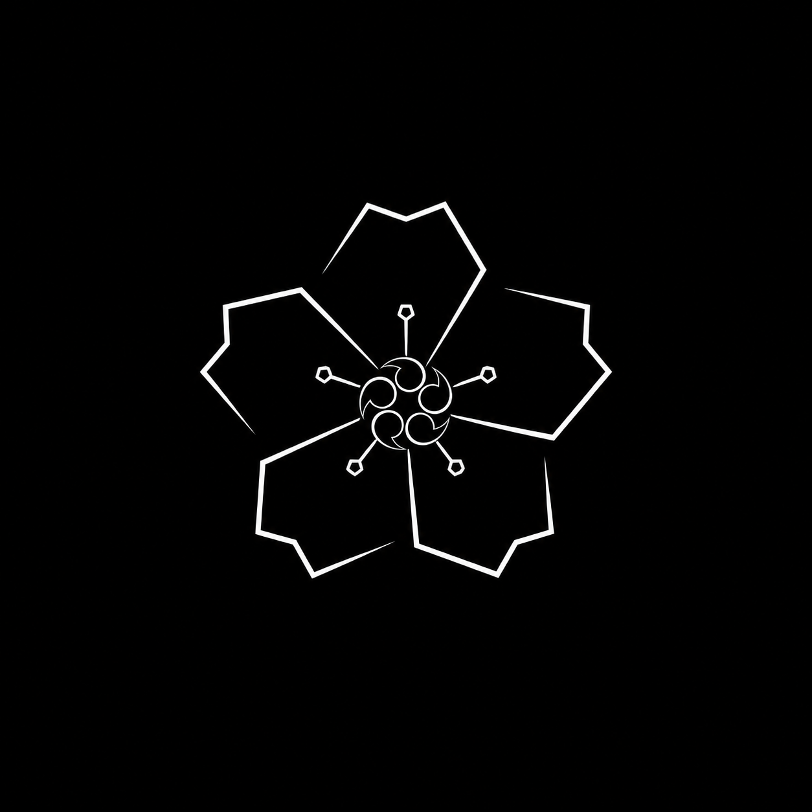
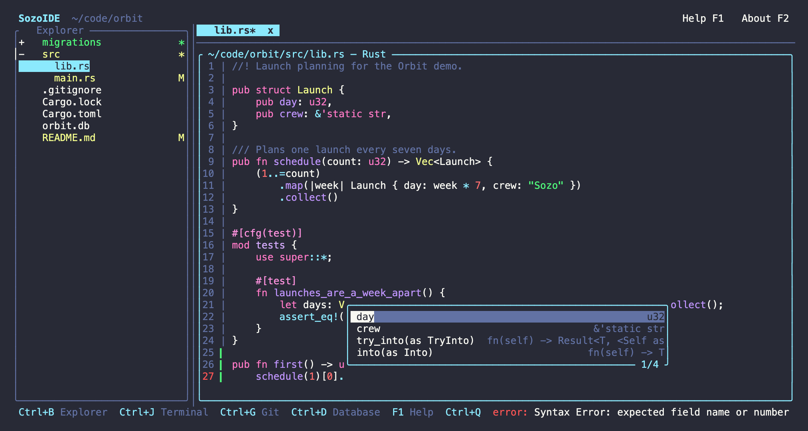
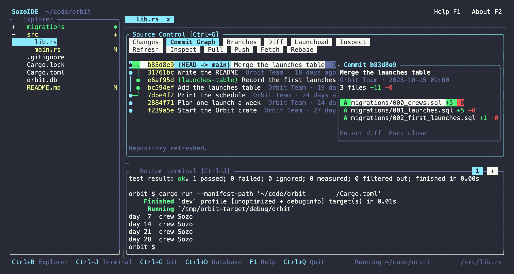
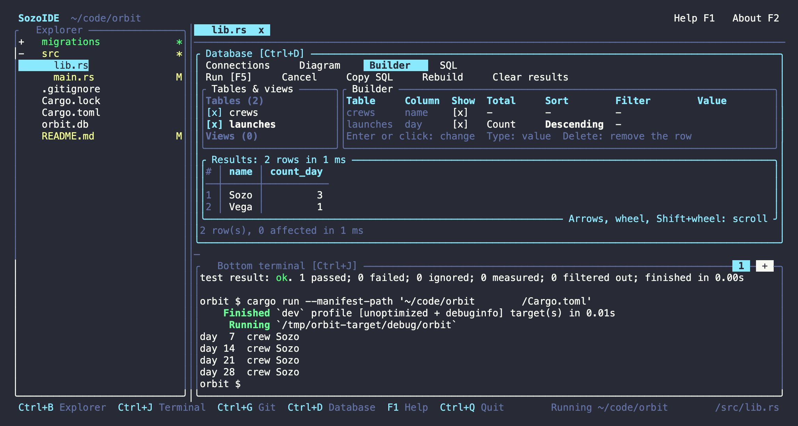

<p align="center">
  
</p>

<h1 align="center">SozoIDE</h1>

<p align="center">
  <b>A whole IDE inside your terminal, in one binary called <code>sozo</code>.</b><br>
  Editor with IntelliSense and a debugger, two terminals, Git, a SQL client and build keys,<br>
  drawn with the colours of your own terminal theme. Windows, macOS and Linux, x86_64 and ARM64.
</p>

<p align="center">
  <a href="https://github.com/vritik246800/SozoIDE/actions/workflows/ci.yml"></a>
  <a href="https://github.com/vritik246800/SozoIDE/releases/latest"></a>
  <a href="https://github.com/vritik246800/SozoIDE/releases"></a>
  <a href="LICENSE"></a>
</p>

<p align="center">
  <a href="#install"><b>Download</b></a> ·
  <a href="https://vritik246800.github.io/SozoIDE/">Website with a live demo</a> ·
  <a href="#try-it-in-a-minute">Try it in a minute</a> ·
  <a href="#keys">Keys</a> ·
  <a href="#troubleshooting">Troubleshooting</a>
</p>

<p align="center">
  
</p>

SozoIDE is for people who work in a terminal all day, over SSH, inside tmux or on a light laptop, and are tired of
switching between an editor, three shells, a Git client and a SQL client. `sozo .` opens them side by side in the
terminal you already have, with the mouse and the keys you already know from a desktop IDE.

<table>
  <tr>
    <td width="50%"></td>
    <td width="50%"></td>
  </tr>
  <tr>
    <td align="center"><b>Source Control</b> (<code>Ctrl+G</code>): every branch on a timeline, the files of a commit, its diff</td>
    <td align="center"><b>Database</b> (<code>Ctrl+D</code>): tick columns, get the <code>SELECT</code> and its rows</td>
  </tr>
</table>

<sub>Real screens of a Linux build, shown in the Dracula theme. SozoIDE has no theme: yours will look like your terminal.</sub>

## Try it in a minute

1. [Download the installer for your system](#install) and open it. No Rust, no Node.js, nothing to compile.
2. Open a terminal in any project and run:

   ```sh
   sozo .
   ```

3. A short tutorial shows each panel once. After it, these are the keys to remember:

   | Key | Opens |
   | --- | --- |
   | `Ctrl+B` | the Explorer |
   | `Ctrl+J` | a shell at the bottom (up to three, in tabs) |
   | `Ctrl+G` | Source Control |
   | `Ctrl+D` | Database |
   | `Ctrl+P` | search in the file (`Ctrl+Shift+P`: in the whole folder) |
   | `Ctrl+R` | runs the open file, or its project, in the bottom shell |
   | `F1` | every key, and the tools SozoIDE can install for you |
   | `Ctrl+Q` | quit; the folder opens as you left it next time |

Everything also answers to the mouse: click, right-click, drag a tab to split the editor, drag a panel to move it.

## Contents

- [Why SozoIDE](#why-sozoide)
- [Features](#features): [Explorer](#explorer) · [Editor](#editor) · [IntelliSense](#intellisense) · [Run](#run) · [Debug](#debug) · [Pictures, videos, 3D models and PDF](#pictures-videos-3d-models-and-pdf) · [Terminals](#terminals) · [Layout](#layout) · [Your own shortcuts](#your-own-shortcuts) · [Source Control](#source-control) · [Database](#database)
- [Install](#install) and [Requirements](#requirements)
- [Usage](#usage) and [Keys](#keys)
- [Updates](#updates), [Privacy](#privacy), [Settings and files](#settings-and-files)
- [Troubleshooting](#troubleshooting) and [Not there yet](#not-there-yet)
- [Build from source](#build-from-source), [Project layout](#project-layout), [Contributing](#contributing), [Releases](#releases), [Security](#security)

## Why SozoIDE

- **One binary, three systems.** `sozo` runs the same on Windows, macOS and Linux, on x86_64 and ARM64, and installs with a native installer.
- **Fast while you type.** Highlighting is redone only from the line you changed (at most a few tens of milliseconds a key on long files), a frame draws in under a millisecond, and language servers, Git, builds and videos run in their own processes or threads: the editor never waits for them.
- **Your terminal's look.** SozoIDE has no colours of its own: it draws with the 16 ANSI colours of your terminal theme and shows every shortcut the way your system types it.
- **Nothing to hunt for.** Help's Dependencies tab lists every tool it and your projects use (`git`, `ffmpeg`, Rust, Node.js, Python, Java, Go, Docker, CMake, the language servers and debuggers) with its version, and installs or updates one with your package manager when you press `Enter`; its row changes by itself once it is done, and a language server installed there starts at once. Nothing is installed without asking.
- **Tested where it runs.** More than 300 tests run on Windows, macOS and Linux on every pull request, with end-to-end ones that drive the real binary through a real PTY; every installer is built natively on its own system and architecture, installed there the way a user would, and only then released.
- **Live.** What you do elsewhere shows at once: the open Source Control follows commits and changes made in a terminal, the Database reads its tables again after `CREATE`, `ALTER` or `DROP`, and the Explorer, the open tabs and the Git marks follow the disk.

## Features

### Explorer

- Every file and folder with an icon for its type, in your terminal's colours, folders first and names in the order people read them (`file2` before `file10`); `▸`/`▾` folders with guides down their rows, and a folder that holds only a folder shown as one row (`src/main/java`).
- The project's name on the title with buttons for a new file, a new folder, reading the tree again and closing every folder. The file of the active tab is revealed and marked.
- A file explorer's keys: `Left` closes a folder or goes up, `Right` opens or goes in, `Home`, `End`, `PageUp`, `PageDown`, `F2` renames, `N` and `Shift+N` make a file and a folder, `Delete` sends to the Trash (`Shift+Delete` deletes for good, after its own question), and `Ctrl+Z` undoes the last move, rename or delete (on macOS the Finder's *Put Back* restores from the Trash).
- `Ctrl`+click and `Shift`+click mark several entries; `/` finds a name anywhere in the project, also in closed folders; drag a row onto a folder to move it there after `Enter`; files your `.gitignore` names are dim (`I` turns it off). Huge folders show 10 000 entries and say how many more.
- Right-click to create a file (its icon follows the extension you type) or a folder, to duplicate, rename or delete (it asks first), to copy the path or show it in your file manager, and to cut, copy and paste files and folders; `Ctrl+X`, `Ctrl+C` and `Ctrl+V` do the same on the selected entry. A copy in the same folder becomes `name copy`, `name copy 2`…; a move never overwrites anything.
- **Properties** in the same menu: kind, location, size, what a folder contains, when it was created, modified and last opened, and its permissions. A big folder says *Calculating…* while it is counted in the background, then shows its size in KB, MB, GB or TB.
- Git marks, as in VS Code: the Source Control letter (`M`, `A`, `U`, `D`, `R`…) at the right of every changed file, its name in the same colour, and on a folder how many files changed inside.
- The tree follows other programs: what they create, rename or delete shows up within a second.
- Long names scroll sideways with `Shift` and the mouse wheel (or a sideways wheel), with a bar along the bottom.
- Each folder opens as you left it, like VS Code: the folders you had open, your tabs with their cursors, the active tab and the panels.

### Editor

- Tabs with a scrolling tab bar; drag a tab to an edge of the editor to split it side by side or stacked, each side with its own tabs.
- Git marks in the margin, as in VS Code: a green bar on lines added since the last commit, a yellow one on lines changed and a red mark where lines were deleted, also for edits not saved yet.
- Edits save themselves after two idle seconds and before you switch tabs or quit. A file changed by another program is read again (your unsaved edits are kept).
- Select with the mouse or `Shift` and the arrows, `Ctrl+A` for everything; copy, cut and paste with `Ctrl+C`, `Ctrl+X`, `Ctrl+V` or the right-click menu, through the system clipboard (and OSC 52 over SSH). `Ctrl+Z` undoes, a word or a paste at a time.
- Syntax highlighting for more than 30 languages, from Rust, Go, C, Java and Python to SQL, JSP, Astro and Mermaid, and for configuration files by their name (`.env`, `Cargo.lock`, `.config`, `.properties`, `Dockerfile`, `Makefile`, `.gitignore`…).
- `[[Links]]` in Markdown, as in Obsidian, show only their text; a click opens the document in a new tab, or goes to its tab.
- Markdown drawn as you read it: headings, quotes, rules, framed code blocks, aligned tables with inline formatting, *italic*, **bold** and ==highlight==, and Mermaid diagrams in box-drawing characters (flowchart, sequence, class, state, C4, ZenUML, Kanban, Radar, Treemap and more). The source comes back under the cursor or the mouse.
- `Ctrl+P` finds in the file as you type and marks every match (`◂ 3/12 ▸`); `Ctrl+Shift+P` searches the whole folder in the background, groups the results by file and skips what `.gitignore` lists.

### IntelliSense

Problems underlined in red (errors) or yellow (warnings), with the message of the cursor's line in the footer; suggestions with `Ctrl+Space`, and by themselves after `.`, `::`, `->` and the second letter of a word. Hold `Ctrl` and rest the mouse on a word for 2 seconds, or press `Ctrl+K`, to read its type and documentation in a small box; `F12` or `Ctrl`+click goes to the definition, in a new tab when it is in another file (a list when there are several), `Alt+F12` peeks at it in a box without leaving the tab, `Shift+F12` lists every reference, and `Alt+Left` goes back. Right-click a word for the same questions: moving over one shows its answers in a small box beside the menu, and a click on an answer opens it. They come from the language server of each language, started when you open its first file; a file without one says so and edits as before. When the server is not installed, or cannot start, asking it something shows the command that installs it on your system; `Enter` runs it in the bottom terminal and, once the server is there, SozoIDE goes on with what you asked:

| Language | Server |
| --- | --- |
| Rust | rust-analyzer |
| C, C++ | clangd |
| Python | pyright |
| Java | jdtls |
| TypeScript, JavaScript | typescript-language-server |
| Go | gopls |
| Shell (sh, bash, zsh) | bash-language-server |
| YAML | yaml-language-server |
| PHP | intelephense |
| HTML, CSS, SCSS, Less, JSON | vscode-langservers-extracted |
| Lua | lua-language-server |

### Run

`Ctrl+R` saves everything, opens the bottom terminal and runs the file there with the tool of its language; a Cargo project or a Go module runs whole. The command stays in the shell's history, so you can run it again.

`F7` builds the project of the open folder, `Shift+F7` cleans it, `Ctrl+F7` cleans and builds it and `Ctrl+F5` runs it; `Shift+F5` stops what it started. The project is found by its manifest, and only commands it really has are used:

| Project | Build / Clean / Run |
| --- | --- |
| Cargo, Go | `cargo build` / `clean` / `run`; `go build ./...` / `go clean` / `go run .` |
| Node.js (`package.json`) | the `build`, `clean` and `dev` or `start` scripts, with npm, pnpm, yarn or bun by the lockfile |
| CMake, Make | `cmake -S . -B build && cmake --build build`, `--target clean`; `make`, `make clean`, `make run` when there are such targets |
| Maven, Gradle | `mvn package` / `mvn clean`; `./gradlew build` / `clean` / `run` (Gradle's `run` with the application plugin) |
| .NET, Swift, Flutter, Dart | `dotnet`, `swift`, `flutter`, `dart` |
| Django, Laravel, Rails | `manage.py runserver`, `artisan serve`, `bin/rails server` |
| Docker | `docker compose build` / `down` / `up --build`; a lone `Dockerfile` builds and runs its image |

The first time, a dialog shows the project, its folder, the file that says so and the command; `Enter` runs it in the bottom terminal. A folder with several projects (a frontend and a backend, say) asks which one. For anything else, put your own commands in `.sozo.toml` at the root of the project:

```toml
[tasks.run]
program = "python3"
args = ["serve.py", "--port", "8000"]
cwd = "backend"   # optional, from the project's root
```

| Language | Command |
| --- | --- |
| Rust | `cargo run` (in a Cargo project) or `rustc` |
| C, C++ | `gcc`/`clang`, `g++`/`clang++` |
| Python | `python3` (`python` on Windows) |
| JavaScript, TypeScript | `node`; `deno`, `bun` or `npx tsx` |
| Java, Kotlin | `java`, `kotlinc` |
| Go | `go run` |
| Ruby, PHP, Lua, Perl, R, Swift, Dart, Zig, Haskell, Elixir, Julia | their own interpreter or compiler |
| Shell, PowerShell, Batch | `bash`, `zsh`, `pwsh`, `cmd.exe` |

### Debug

`F9` puts a breakpoint (`●`) on the cursor's line. `F5` saves, builds the file with debug symbols in the background (a Cargo project with `cargo build`, a single Rust, C or C++ file with `rustc -g`, `clang -g` or `gcc -g`) and starts the debugger; when it stops, the editor jumps to the line (`▶`) and a panel on the right shows the call stack, the variables and the program's output. `F5` continues, `F10` steps over, `F11` steps into and `Shift+F5` stops.

| Language | Debugger (Debug Adapter Protocol) |
| --- | --- |
| Rust, C, C++ | lldb-dap (comes with Xcode and LLVM), or GDB 14 and later (`gdb -i dap`) |
| Python | debugpy |
| Go | Delve (`dlv dap`) |

### Pictures, videos, 3D models and PDF

- Pictures (PNG, JPEG, GIF, WebP, BMP, ICO, TIFF, TGA, PNM, QOI, HDR), animated GIFs and videos (MP4, MOV, MKV, WebM, AVI, M4V) are drawn in half blocks in their own colours, two pixels a cell, on any terminal. Videos play through the system's `ffmpeg` at 15 frames a second, in your terminal's picture protocol when it has one (Kitty, Sixel, iTerm2), with sound through `ffplay`: a bar under the video shows the time and has buttons to play, pause, stop, seek, change the volume and the speed and fill the screen; click or drag the bar to seek, click the video to pause, and the wheel changes the volume.
- 3D models (`.glb`, `.gltf`) open in a tab, lit and with their colours: `←`/`→` turn them, `↑`/`↓` tilt them, `+`/`-` or the wheel zoom, and a drag turns them with the mouse.
- PDF files open one page at a time. A page with only text shows its text, sharp, to select, copy and search with `Ctrl+P`; a page with a picture, a diagram or another drawing shows whole as a small picture through your terminal's picture protocol (Sixel, Kitty or iTerm2), or half blocks without one.

### Terminals

A bottom and a right terminal, each with its own shell, that work as any terminal: full-screen programs such as Claude Code, vim and htop get the wheel, the mouse and every key, `Ctrl` and a letter go to the program (`F6` leaves the terminal), and a shell has 10,000 rows of scrollback on the wheel or Page Up and Page Down. The bottom one opens up to three shells, each in a tab: click `+` for another one and the `x` of a tab to close it (one always stays). The right one always has two tabs. `Ctrl+PageDown` and `Ctrl+PageUp` switch tabs. Drag the mouse over a terminal to select its text: letting go copies it. `Shift+Enter` writes a new line without running it, as zsh, fish and tools like Claude Code expect (your terminal has to tell SozoIDE about Shift: kitty, WezTerm, Ghostty, iTerm2 and Windows do). Drag the dividers to resize every panel. On Windows the terminals need Windows 10 version 1809 or newer; on an older one SozoIDE opens without them.

On macOS and Linux, tmux is optional: with it installed, `T` in Help's Dependencies tab runs each shell in a tmux session of its folder, so it keeps running after SozoIDE closes, and comes back the next time. Your tmux configuration stays as it is. On Windows tmux lives inside WSL, so the terminals are the plain ones.

### Layout

Drag a panel by its title or by any corner of its border to place it, the editor too, from the free part of its tab bar. A solid box shows exactly where it will land before you let go: to a side of another panel to share its place, to its centre to swap them, or to the edge of the window to take that whole edge. The rest adjusts, as in a tiling window manager. Drag a side or bottom border, or a divider, to resize a panel wherever you placed it. Each folder remembers its layout.

### Your own shortcuts

Every command that works anywhere or in the editor can have the key you choose: open Help (`F1`), click its key (or move to it with `Tab` and press `Enter`), then press the new keys, with `Ctrl`, `Alt` (`Option` on a Mac) or a function key. A key that another command had swaps with it, so no command is left without one. Your keys are saved in `keys.toml` in SozoIDE's settings folder and show everywhere: the footer, the panel titles, the tutorial and Help. `Reset shortcuts [R]` brings back the ones SozoIDE came with.

### Source Control

Stage and commit, and scroll back through a timeline of every branch, each in its own colour with dots and merge lines: click a commit to slide in its files, and a file to see what was added (green), removed (red) or modified (yellow). Every branch in a tree grouped by remote and folder; click one to switch to it. The Launchpad shows your branch, its upstream, how far ahead and behind it is, and the staged, unstaged and untracked files. The diff numbers its lines, folds its hunks, goes side by side and moves to the next changed file; stage, unstage or discard one hunk, or only the lines you mark. Discard a file (a copy is kept first), amend the last commit, write a message with a title and a body, stash, create, rename and delete branches, make tags, and solve a merge conflict block by block. `Alt+G` shows who changed each line, `Alt+H` the commits that changed the file. Pull is fast-forward only, a branch that is not on the remote is published, nothing is ever force-pushed, and errors say what to do; rebase, checkout, discards and deletes ask before they run, and the dialog names the repository's hooks that may run.

### Database

Connect to SQLite, PostgreSQL and MySQL and the tables and views appear on the left. Draw some as a diagram with their keys and relations, tick columns to build the query (group, count, sum, average, sort and filter) and get the `SELECT` with its joins in the SQL tab, ready to edit, copy or run with `Ctrl+Enter` or `F5`. The rows scroll both ways and come a thousand at a time (`L` loads more, `#` counts them all; `query_timeout_seconds` in `settings.toml` stops a slow query). On a table with a primary key, `Enter` edits a cell, `Delete` deletes a row and `+` copies one: each is shown as its statement with parameters and runs only after `Enter`. Copy the results as CSV, JSON or Markdown (`C`, `J`, `M`; with `Shift`, to a new file), see a long cell whole with `Space`, run `EXPLAIN` with `Alt+E`, open more SQL tabs with `Alt+T`, walk the history of a connection with `Alt+Up`/`Alt+Down` (a query with a password is never kept) and complete table and column names with `Ctrl+Space`. Each connection says whether it is encrypted; TLS can be preferred, required or verified, and a connection to another machine without it is warned about. A connection remembers its driver, host, user and database; its password goes to the system keyring — the Keychain on macOS, the Credential Manager on Windows, GNOME Keyring or KWallet on Linux — and never to a file. On Linux without a keyring running, the panel says the password was not saved.

### A guided start

A short tutorial on the first start (skip it with `Esc`), and after an update a note with what is new in every version since the one you had. In About, `Release notes [N]` shows the notes of every version; `Tab` shows only what is new or only what was fixed. `F1` lists every key in boxed sections; the footer shows what just happened.

## Install

Download the installer for your system and open it. Then open a new terminal in any folder and run `sozo .`

| System | Download | Install |
| --- | --- | --- |
| macOS (Apple silicon) | [SozoIDE-macos-arm64.dmg](https://github.com/vritik246800/SozoIDE/releases/latest/download/SozoIDE-macos-arm64.dmg) | Drag SozoIDE to Applications and open the app once: it offers to install the `sozo` command in `/usr/local/bin`. |
| Windows x86_64 | [SozoIDE-windows-x86_64.msi](https://github.com/vritik246800/SozoIDE/releases/latest/download/SozoIDE-windows-x86_64.msi) | Follow the setup wizard. Installs for your user only, without administrator rights, and adds `sozo` to your PATH. |
| Windows ARM64 | [SozoIDE-windows-arm64.msi](https://github.com/vritik246800/SozoIDE/releases/latest/download/SozoIDE-windows-arm64.msi) | Same as x86_64. |
| Debian, Ubuntu | [x86_64](https://github.com/vritik246800/SozoIDE/releases/latest/download/SozoIDE-linux-x86_64.deb), [ARM64](https://github.com/vritik246800/SozoIDE/releases/latest/download/SozoIDE-linux-arm64.deb) `.deb` | Open it in your software installer, or `sudo apt install ./SozoIDE-linux-*.deb` |
| Fedora, openSUSE | [x86_64](https://github.com/vritik246800/SozoIDE/releases/latest/download/SozoIDE-linux-x86_64.rpm), [ARM64](https://github.com/vritik246800/SozoIDE/releases/latest/download/SozoIDE-linux-arm64.rpm) `.rpm` | Open it in your software installer, or `sudo dnf install ./SozoIDE-linux-*.rpm` |
| Other Linux | [x86_64](https://github.com/vritik246800/SozoIDE/releases/latest/download/SozoIDE-linux-x86_64.tar.gz), [ARM64](https://github.com/vritik246800/SozoIDE/releases/latest/download/SozoIDE-linux-arm64.tar.gz) `.tar.gz` | Extract `sozo` into a folder on your PATH. |

The installers are not signed yet:

- **macOS:** if the app does not open, go to System Settings, Privacy & Security, and choose Open Anyway.
- **Windows:** if SmartScreen appears, choose More info, then Run anyway.

Each release includes `SHA256SUMS.txt`, and updates from inside SozoIDE check the package against it before installing. From version 0.9.0 every package also carries a build provenance attestation: `gh attestation verify <file> --repo vritik246800/SozoIDE` says which workflow run and commit built it. Check a download with `shasum -a 256 -c SHA256SUMS.txt --ignore-missing` on macOS, `sha256sum -c SHA256SUMS.txt --ignore-missing` on Linux, or `Get-FileHash` on Windows.

### Requirements

- A [Nerd Font](https://www.nerdfonts.com/) in your terminal for the icons.
- SozoIDE runs `git` (Source Control), `curl` (updates), `ffmpeg` with `ffprobe` and `ffplay` (videos and their sound) and the language servers instead of linking them. On the first start, and after an update that brings a new tool, a panel lists what makes SozoIDE better (`git`, `curl`, `ffmpeg`, `tmux`): choose what to install or skip it. After a new installation and after each update the footer says what is missing; Help's Dependencies tab (`F1`, then `Right`) shows each one and installs it, after `Enter`, in the bottom terminal:

| Tool | macOS | Windows | Linux |
| --- | --- | --- | --- |
| `git`, `curl`, `ffmpeg` | Homebrew | `winget` | `apt-get` or `dnf` (also recommended by the DEB and RPM packages) |
| `tmux` (optional) | Homebrew | inside WSL | `apt-get` or `dnf` (also recommended by the DEB and RPM packages) |
| rust-analyzer | `rustup` or Homebrew | `rustup` | `rustup` |
| clangd | Xcode command line tools | `winget` (LLVM) | `apt-get` or `dnf` |
| pyright, typescript-language-server | `npm` (or `pip` for pyright) | `npm` | `npm` |
| gopls | `go install` | `go install` | `go install` |
| jdtls | Homebrew | — | Homebrew |
| Debuggers | lldb-dap with Xcode; debugpy with `pip`; Delve with `go install` or Homebrew | lldb-dap with LLVM; debugpy with `pip`; Delve with `go install` | GDB with `apt-get` or `dnf`; debugpy with `pip`; Delve with `go install` |
| Rust, Node.js, Python, Java, Go, Docker, CMake | Homebrew | `winget` | `apt-get` or `dnf` |

On Linux the command starts with `sudo`, which asks for your password in the terminal.

From a terminal, `install-tools.sh` (macOS, Linux) and `install-tools.cmd` (Windows), attached to each release, install the same tools: they skip what is there, ask first, and `--check` only says what is missing.

## Usage

```sh
sozo                   # open the current folder
sozo path/to/project   # open another folder
sozo --help
sozo --version
```

### Keys

`F1` inside SozoIDE always shows the keys of your own system, with the ones you changed. The ones to start with are in [Try it in a minute](#try-it-in-a-minute); this is the whole list SozoIDE comes with.

<details>
<summary><b>Every key and mouse gesture</b></summary>

| Key | Action |
| --- | --- |
| `Ctrl+B` | Show or hide the Explorer |
| `Ctrl+J` | Show or hide the bottom terminal |
| `Ctrl+Shift+B` (macOS: `Ctrl+Option+B`, Linux: `Ctrl+Alt+B`) | Show or hide the right terminal |
| `Ctrl+PageDown` / `Ctrl+PageUp` (terminal) | Next / previous tab of the terminal |
| Click `+` / `x` (bottom terminal) | Another shell in a tab, up to three / close that tab |
| `F6` (terminal) | Leave the terminal; with the focus there, `Ctrl` and a letter go to the program that runs in it |
| Drag the mouse (terminal) | Select text; letting go copies it. Over a program that uses the mouse, `Shift`+drag selects |
| `Shift+Enter` (terminal) | New line without running it |
| `Ctrl+G` | Open or close Source Control |
| `Ctrl+D` | Open or close Database |
| `Ctrl+P` | Search the open file |
| `Ctrl+Shift+P` | Search the whole folder |
| `Up` / `Down`, `◂` / `▸` (search) | Previous / next result; `Enter` opens it selected |
| Right-click in the Explorer | New file, new folder, cut, copy, paste, duplicate, rename, delete (after a confirmation), copy path, reveal in file manager, properties |
| `Left` / `Right`, `Home` / `End`, `PageUp` / `PageDown` in the Explorer | Close a folder or go up / open or go in; first, last; a page |
| `F2`, `N`, `Shift+N` in the Explorer | Rename, new file, new folder (elsewhere `F2` is About) |
| `Delete`, `Shift+Delete`, `Ctrl+Z` in the Explorer | To the Trash, delete for good, undo the last move, rename or delete |
| `Ctrl`+click, `Shift`+click, `/`, `I` in the Explorer | Mark several, a range; find a name in the whole project; dim ignored files or not |
| Drag an Explorer row onto a folder | Move it there, after `Enter` |
| `Ctrl+X` / `Ctrl+C` / `Ctrl+V` in the Explorer | Cut / copy / paste the selected file or folder (paste goes into the selected folder) |
| `Ctrl+W` | Close the active tab |
| `Ctrl+Y` / `Ctrl+Shift+Z` | Redo |
| `Ctrl+/` | Comment or uncomment the lines |
| `Ctrl+L` | Go to a line (`line:column`) |
| `Alt+Z` | Wrap long lines on screen (Markdown wraps by itself) |
| `Ctrl+H` | Replace in the search; `Alt+C`/`Alt+W`/`Alt+R` for case, whole word and regular expressions; `Ctrl+Enter` replaces all (in a folder, after a list and `Enter`) |
| `Ctrl+O` / `Ctrl+Shift+O` | Open a file by a few of its letters / every command with its key |
| `Tab` / `Shift+Tab`, `Alt+Up` / `Alt+Down`, `Shift+Alt+Down`, `Ctrl+Shift+K` | Indent or outdent, move, duplicate, delete the selected lines |
| `Ctrl+Left` / `Ctrl+Right`, `Ctrl+Backspace` | A word back or forward, delete the word before |
| Double / triple click | Select the word / the line |
| `/` in Help | Find a shortcut |
| `F2` in the editor | Rename the symbol in every file (edits in more than one file wait for `Enter`) |
| `Shift+Alt+F`, `Ctrl+.` | Format the file or the selection; code actions and quick fixes |
| `Ctrl+Shift+M`, `@` / `#` in `Ctrl+O` | Every problem of the project; symbols of the file / of the project |
| `Shift+F11`, `Ctrl+F10`, `F8` | Step out, run to the cursor, pause |
| `Shift+F9`, `Ctrl+Shift+W`, `Ctrl+Shift+E` | A breakpoint with a condition, a count or a message; watch an expression; evaluate one at the pause |
| `Ctrl+Enter` or `F5` | Run the SQL query |
| `F1` | Help with every command; `Left` / `Right` switch to the Dependencies tab and back |
| `Up`/`Down`, `Enter`, `R`, `T` (Dependencies) | Choose a tool; show its install or update command, then `Enter` runs it; check again; tmux on or off (macOS, Linux) |
| Drag a panel's title or a corner of its border | A box shows where it lands: to a side of a panel to share its place, to its centre to swap them, or to the window's edge; the editor moves from the free part of its tab bar |
| Drag a divider, or a side or bottom border | Resize the panels on either side |
| Click a `[[link]]` (Markdown) | Open the document in a new tab, or go to its tab |
| Click a key, or `Tab` and `Enter` (Help) | Change that shortcut: press the new keys; `Esc` gives up, `R` then `Enter` resets them all |
| `F2` | About, with the version |
| `Ctrl+Q` | Quit and restore the terminal |
| `Tab` / `Shift+Tab` | Move between tabs or fields |
| `Enter` | Open, activate or confirm |
| `Esc` | Close the dialog or panel |
| `Page Up` / `Page Down` | Scroll the editor or the terminal history |
| Mouse wheel | Scroll panels and terminal history; full-screen programs in a terminal get it |
| `Shift` + mouse wheel | Scroll the editor or the Explorer sideways |
| Mouse wheel on the tabs, `‹` / `›` | Scroll the tab bar |
| Drag a divider | Resize the Explorer and the terminals |
| Drag a tab | To an edge of the editor: split it, each side with its own tabs; to the other side: move it there (a side without tabs closes) |
| `Shift` + arrows, `Home`, `End`, or drag the mouse | Select text in the editor |
| `Ctrl+A` | Select all the text |
| `Ctrl+Z` (also on macOS) | Undo the last edit in the editor |
| `Ctrl+C` / `Ctrl+X` | Copy / cut the selection to the system clipboard |
| `Ctrl+V`, right-click in the editor | Paste the system clipboard; the menu also cuts and copies the selection |
| `←`/`→`, `↑`/`↓`, `+`/`-`, drag, wheel (3D model) | Turn, tilt, zoom in and out |
| `Space`, `S` (video) | Play or pause (at the end, play again); stop at the start |
| `←` / `→`, `Shift` + `←` / `→` (video) | Back / forward 5 seconds, 30 seconds |
| `-` / `+` or wheel, `M`, `[` / `]` (video) | Volume down / up, mute, slower / faster |
| `F`, `Esc` (video) | Full screen; leave it, then close the video |
| `Ctrl+Space` / `F12` | Suggestions from the language server (they also open after `.`, `::`, `->` and the second letter of a word) / go to the definition (a list when there are several) |
| `Alt+F12` / `Shift+F12` | Peek at the definition in a box (`Up`/`Down` scroll, `Enter` goes there, `Esc` closes) / list every reference |
| `Ctrl+K`, or hold `Ctrl` and rest the mouse on a word for 2 s | Type and documentation of the symbol (`Up`/`Down` scroll a long one, `Esc` closes) |
| `Ctrl`+click / `Alt+Left` | Go to the definition, in a new tab when it is in another file / back to where you were before |
| `F9` / `F5` / `F10` / `F11` / `Shift+F5` | Breakpoint / build and debug, or continue / step over / step into / stop debugging, or what `F7` or `Ctrl+F5` started |
| `F7` / `Shift+F7` / `Ctrl+F7` / `Ctrl+F5` | Build / clean / clean and build / run the project, in the bottom terminal |
| Right-click (editor) | Cut, copy, paste; go to the definition, declaration, type definition or implementations; peek; find references (move over one to see its answers beside the menu, click an answer to open it) |
| `Ctrl` over a word | Underlines it: `Ctrl`+click goes to its definition |
| `Ctrl+R` (editor or Explorer) | Save, open the bottom terminal and run the file there: a Cargo project or Go module runs whole; C, C++, Rust, Python, JavaScript, TypeScript, Java, Kotlin, Go, Ruby, PHP, Lua, Perl, R, Swift, Dart, Zig, Haskell, Elixir, Julia and shell scripts with their own compiler or interpreter |
| `Page Down` / `→` / mouse wheel, `Page Up` / `←`, `Home` / `End` (PDF) | Next page, previous page, first and last page; on a page of text the arrows move the cursor, `Shift` selects, `Ctrl+C` copies and the wheel scrolls on to the next page |
| Click a branch (Source Control) | Switch to it, after a confirmation |
| Click a commit or `Enter` (Commit Graph) | Its files; `Enter` on a file: its diff; `[` / `]` other file; `Esc` back |
| `Enter` / `Space`, `F6`, `Delete`, `Shift` + wheel (Database) | Add a table, tick a column, change a builder cell; next part; remove the builder row; scroll the results sideways |
| `n` / `p`, `[` / `]`, `v`, `s` / `u`, `o` (Diff) | Next / previous hunk, previous / next changed file, side by side, stage / unstage, open the file |
| `S` / `U` / `D`, `Space` (Diff) | Stage / unstage / discard the hunk (discard asks); mark a line so the hunk keys take only the marked ones |
| `d`, `a`, `z`, `1` / `2` / `3` (Changes) | Discard the file (asks), amend, stash; in a conflicted file keep mine / theirs / both for its first block |
| `b`, `r`, `Delete` / `Shift+Delete`, `t`, `[` / `]`, `a`, `x` (Branches) | New, rename, delete a merged branch / any branch (asks), new tag; choose a stash entry, apply it, drop it (asks) |
| `m` (Commit Graph), `Alt+Enter` (commit message) | More commits; a new line in the message |
| `Alt+G` / `Alt+H` (editor) | Who changed each line / the commits that changed the file |
| `F3` / `Shift+F3` / `Shift+F6` (terminal) | Find in the history (`Enter` older, `Shift+Enter` newer) / clear it / two shells side by side |
| `Ctrl`+click, right click on a tab (terminal) | Open the web address or the `file:line` a program printed (web addresses and files of the project only) / name the tab |
| `+` / `-` / wheel, arrows, `0` (picture) | Zoom, move, fit again |
| `Ctrl+P`, `Ctrl+L`, `@` in `Ctrl+O` (PDF) | Find on every page, go to a page, the table of contents |
| `C` / `A` (video), `W` / `0` / `P` (3D model) | Subtitles / sound track; wireframe / reset the view / play its animation |
| Click a task box, a link or a note (Markdown) | Tick it; open the file at its heading; go to the note |
| `Ctrl+M`, `Alt+0`, `Alt+L` | One panel over the whole window and back; the layout SozoIDE came with; three layouts kept with a name |
| `Ctrl+Alt` + arrows / `Ctrl+Alt+Shift` + arrows | Focus the panel on that side / move the panel to that edge |
| `Alt+F7` / `Alt+F8` / `Alt+F9` | A named task of `.sozo.toml` / the last one again / the test under the cursor, each after its dialog |
| `Alt+S` / `Alt+D` / `Shift+F10` | The file also in the other pane, kept the same / compare it with another side by side / the menu of a right click |
| `Enter`, `Delete`, `+`, `Space`, `C` / `J` / `M`, `L`, `#` (Database results) | Edit the cell, delete the row, copy the row (each after `Enter` on its statement); the cell whole; copy as CSV / JSON / Markdown (`Shift`: a file); load more; count |
| `Alt+E`, `Alt+T`, `Alt+W`, `Alt+1`…`9`, `Alt+Up` / `Alt+Down`, `Ctrl+Space` (Database) | `EXPLAIN`; new / close / go to an SQL tab; history of the connection; complete a name |
| `Up` / `Down` or the mouse wheel (Help, What's new) | Scroll a dialog taller than the terminal |
| `G` (in About) | Open the repository to contribute |
| `U` (in About) | Check for updates now, also a version you skipped |
| `N` (in About) | The notes of every version; `Tab` shows only what is new or only what was fixed |

</details>

### Motion

Panels grow from their divider, Source Control and Database draw in line by line, a tab comes in from its side, and dialogs open from their middle row with the rest of the screen dimmed. Transitions never hold up saving, commits or queries. In About the SozoIDE flower grows from its centre. Set `SOZO_REDUCED_MOTION=1` to turn them off.

### Updates

When a newer release is out, SozoIDE tells you at startup. Press `Enter` (or `U`) to update: SozoIDE downloads the installer for your system, installs it and restarts in the same folder. Press `S` to skip that version, or `Esc` to decide later. On Debian, Ubuntu and Fedora the update runs `sudo`, so it asks for your password. Set `SOZO_NO_UPDATE_CHECK=1` to turn the check off. The first start after an update shows what the new version brings.

### Privacy

On its first start SozoIDE counts the installation once: it downloads the small `SozoIDE-<system>-<arch>.installed.txt` file of its release, and GitHub's public download counter goes up by one. The first start after an update does the same with `SozoIDE-<system>-<arch>.updated.txt`. That counter only knows the system, the architecture and the version; nothing about you or your files is sent, and SozoIDE has no server of its own. Set `SOZO_NO_TELEMETRY=1` to turn both off. The startup check for updates also asks GitHub for the latest release (`SOZO_NO_UPDATE_CHECK=1` turns it off).

### Settings and files

SozoIDE has no settings screen to learn: it remembers what you do and reads three environment variables.

| Variable | Effect |
| --- | --- |
| `SOZO_REDUCED_MOTION=1` | No transitions: panels, tabs and dialogs appear at once |
| `SOZO_NO_UPDATE_CHECK=1` | Does not ask GitHub for the latest release at startup |
| `SOZO_NO_TELEMETRY=1` | Does not count the installation or the update |

What it remembers lives in its settings folder: `~/Library/Application Support/SozoIDE` on macOS, `~/.config/sozoide` on Linux and `%APPDATA%\SozoIDE\config` on Windows. Deleting `keys.toml` or `sessions.toml` brings back the keys and the layouts SozoIDE came with.

| File | Holds |
| --- | --- |
| `settings.toml` | Written with the defaults the first time: `autosave_seconds` (0 turns it off), `tab_width`, `insert_spaces`, `wrap`, `wrap_markdown`, `reduced_motion`, `check_updates`, `telemetry`, `format_on_save`, `query_timeout_seconds` (a Database query stops after it; 0 lets it run), `terminal_scrollback`, `high_contrast` (attributes only, like `NO_COLOR=1`); the `SOZO_*` variables still win, and a broken file is kept aside as `settings.toml.broken` |
| `keys.toml` | Only the shortcuts you changed |
| `sessions.toml` | For each folder: open folders and tabs, cursors, panels and their layout |
| `connections.toml` | Database connections, without their passwords |
| `update.toml` | The version you skipped, the last version that ran, the tools already offered, tmux on or off |

In a project, an optional `.sozo.toml` at its root holds [your own build and run commands](#run).

## Troubleshooting

| What you see | Why, and what to do |
| --- | --- |
| Boxes or question marks where the icons should be | Your terminal's font has no icons: choose a [Nerd Font](https://www.nerdfonts.com/) in its settings |
| Colours that are hard to read | They are your terminal theme's 16 colours, not SozoIDE's: try another theme in your terminal |
| `Ctrl+Shift+B` does not open the right terminal | On macOS and Linux most terminals send it as `Ctrl+B`. Use `Ctrl+Option+B` on macOS (with Option as Meta: Terminal, Settings, Profiles, Keyboard) and `Ctrl+Alt+B` on Linux, or choose another key in Help |
| `Ctrl+Shift+P` searches the file, not the folder | The terminal (or tmux) does not tell SozoIDE about Shift: give "search the folder" another key in Help (`F1`) |
| `Shift+Enter` runs the line in a terminal | Same reason: kitty, WezTerm, Ghostty, iTerm2 and Windows report Shift; others may not |
| A key does nothing while a terminal has the focus | `Ctrl` and a letter go to the program in that terminal. Press `F6` to leave it first |
| "could not start" or no suggestions in the editor | The language server of that file is missing: ask something (`F12`, `Ctrl+K`) and SozoIDE shows the command that installs it, or install it from Help's Dependencies tab |
| A video plays without sound | `ffplay` is missing; it comes with most `ffmpeg` packages, which Help's Dependencies tab installs |
| No terminals on Windows | They need Windows 10 version 1809 or newer |
| macOS says the app cannot be opened, or SmartScreen appears on Windows | The installers are not signed yet: see [Install](#install) |
| `sozo: command not found` after installing | Open a new terminal. On macOS, open the SozoIDE app once: it offers to install the command |
| Pictures look blocky | Your terminal has no picture protocol (or tmux hides it): SozoIDE draws them in half blocks. kitty, WezTerm and iTerm2 show them sharp |
| Everything is in one colour | `NO_COLOR` is set, or `high_contrast = true` in `settings.toml`: SozoIDE draws with bold, underline and reverse only |
| Panels are missing in a small window | Under 80×24 they give way in order (right terminal, bottom terminal, Explorer); make the window larger and they come back |
| An update did not start | SozoIDE keeps the version before it until the new one opens, and goes back to it when the new one does not start |
| A Database query stops after a minute | That is `query_timeout_seconds` in `settings.toml` (0 lets it run) |

Something else? [Open an issue](https://github.com/vritik246800/SozoIDE/issues) with the output of `sozo --diagnose` (version, system, terminal and tools found, without your paths).

### Terminals

| Terminal | Keys with Shift | Mouse | Pictures | Notes |
| --- | --- | --- | --- | --- |
| kitty | yes | yes | sharp (kitty graphics) | |
| WezTerm | yes | yes | sharp (iTerm2 images) | |
| iTerm2 | yes | yes | sharp | Option as Meta for the `Alt` keys |
| Terminal.app | some (`Ctrl+Option+B` for the right terminal) | yes | half blocks | Option as Meta for the `Alt` keys |
| Windows Terminal | yes | yes | half blocks | |
| GNOME Terminal | some | yes | half blocks | `Ctrl+Alt+B` for the right terminal |
| tmux (inside any of them) | depends on `extended-keys` | yes | half blocks | `set -g allow-passthrough on` lets pictures through |

## Not there yet

So you know before you install:

- **Signed installers.** macOS and Windows warn on the first open; each release has `SHA256SUMS.txt` to check your download.
- **Intel Macs.** The macOS build is for Apple silicon only.
- **Package managers.** Each release carries the manifests of Scoop (`scoop install https://github.com/vritik246800/SozoIDE/releases/latest/download/sozoide.json`), winget, the AUR and a Homebrew cask, but they are not in those catalogues yet: installing is a download, updating is one key inside SozoIDE.
- **tmux sessions on Windows.** tmux lives inside WSL there, so the terminals are the plain ones.
- **Plugins and themes.** There are none: what SozoIDE does is in the binary, and its colours are your terminal's.

## Build from source

You need Rust stable and Git.

```sh
git clone https://github.com/vritik246800/SozoIDE.git
cd SozoIDE
cargo build --release
./target/release/sozo .
```

Before sending changes, run:

```sh
cargo fmt --check
cargo clippy --all-targets -- -D warnings
cargo test
cargo test --release --test first_start   # macOS and Linux: what only a release build does
bash packaging/security-check.sh           # secrets, local files, workflows, cargo audit, npm audit
```

`security-check.sh` uses `cargo-audit` when it is installed (`cargo install --root target/tools --locked cargo-audit`). The advisories that cannot be fixed yet are listed, each with its reason, in `.cargo/audit.toml`. CI runs the same commands on every pull request and every Monday.

### Native packages

| System | Command | Output |
| --- | --- | --- |
| macOS | `bash packaging/build-macos.sh` | Apple silicon `.dmg` in `target/package/macos` |
| Linux | `bash packaging/build-linux.sh` | `.deb`, `.rpm` and `.tar.gz` in `target/package/linux` |
| Windows | `powershell -ExecutionPolicy Bypass -File packaging/build-windows.ps1` | `.msi` in `target/wix` |

Packaging tools are installed into `target/tools`, never globally. `bash packaging/test-install.sh` (macOS, Linux) and `packaging/test-install.ps1` (Windows) install the package the way a user would and check `sozo --version`.

### Website

```sh
cd site
npm ci
npm run dev
```

## Project layout

```text
src/          the application:
  app/        state, keys and your own shortcuts, mouse, Explorer, IntelliSense list, project tasks and Dependencies, each folder's session
  editor/     text, highlighting, Markdown, Mermaid, PDF, search
  lsp/        language server client (JSON-RPC over stdio)
  run/        the command Ctrl+R runs, and the project F7, Shift+F7, Ctrl+F7 and Ctrl+F5 build, clean and run
  debug/      the debugger client (Debug Adapter Protocol)
  media/      pictures, GIFs, videos and 3D models in half blocks
  terminal/   the PTY terminals and their tabs
  git/        Source Control
  database/   SQLite, PostgreSQL and MySQL
  update/     updates and Help's Dependencies tab
  ui/         drawing
  animation/  transitions
  process.rs  questions to system tools: no input, and stopped after their time
  storage.rs  settings files: written whole, readable only by you, kept aside when broken
tests/        CLI, end-to-end and interaction tests in a real PTY
packaging/    native installers for Linux, macOS and Windows, and security-check.sh, the security gate of the hook and CI
.cargo/       audit.toml: the advisories cargo audit may skip, and why
site/         landing page (Astro), published to GitHub Pages; site/scripts captures its SozoIDE screens
assets/       logo and the screens of this README
.github/      CI, release and Pages workflows, and repository rulesets
.githooks/    local pre-commit and pre-push hooks
```

## Contributing

- Development happens on the `preview` branch. `main` only changes through pull requests with green CI.
- Open pull requests against `preview`.
- After cloning, turn on the local hooks: `git config core.hooksPath .githooks`. They refuse commits on `main`, and commits that add secrets, personal paths or local files.
- Commit messages start with `create:`, `update:`, `fix:` or `docs:`, followed by a short summary in English.
- Before a commit, run what the CI runs, in its order: `cargo fmt --check`, `cargo clippy --all-targets -- -D warnings`, `cargo test`, `cargo test --release --test first_start`, `cargo test --features budgets --bin sozo budgets -- --test-threads=1`, `npm run build --prefix site`, `node site/scripts/check-site.mjs` and `bash packaging/security-check.sh`. The maintainer keeps these steps in a local script; they are all here.

## Releases

1. Raise `version` in `Cargo.toml` on `preview` and merge it into `main` through a pull request.
2. Tag `main` with the same version and push the tag: `git tag v0.1.0 && git push origin v0.1.0`
3. The Release workflow checks that the tag is the version in `Cargo.toml` and a commit of `main` (`packaging/check-release.sh`), runs the security gate again, builds every installer, installs it on its own system, attests it, and publishes the release with install notes and `SHA256SUMS.txt`. Package names carry no version, so `releases/latest/download/<name>` always points at the newest one.
4. Check that every download link on the website now delivers the new version: `bash packaging/check-downloads.sh`

## Security

Report vulnerabilities privately on GitHub, under Security, Report a vulnerability. Please do not open a public issue for them.

SozoIDE asks before it runs code of a folder: the first time a language server, the debugger or a command of the project is needed, it shows «Trust the folder …?». Without trust you can still read, edit, search and use Git. Files over 5 MB open read only, updates are downloaded to a private folder over HTTPS only and checked against `SHA256SUMS.txt`, and a crash gives the terminal back and leaves `crash.log` in the cache folder (it never holds the text of your files).

Every pull request passes a Security check: no secrets or personal paths in the repository, workflows with the least permissions, and no known vulnerability in the Rust crates (`cargo audit`) or in the packages of the website (`npm audit`).

## License

[Apache License 2.0](LICENSE) © Vritik Valabdas
